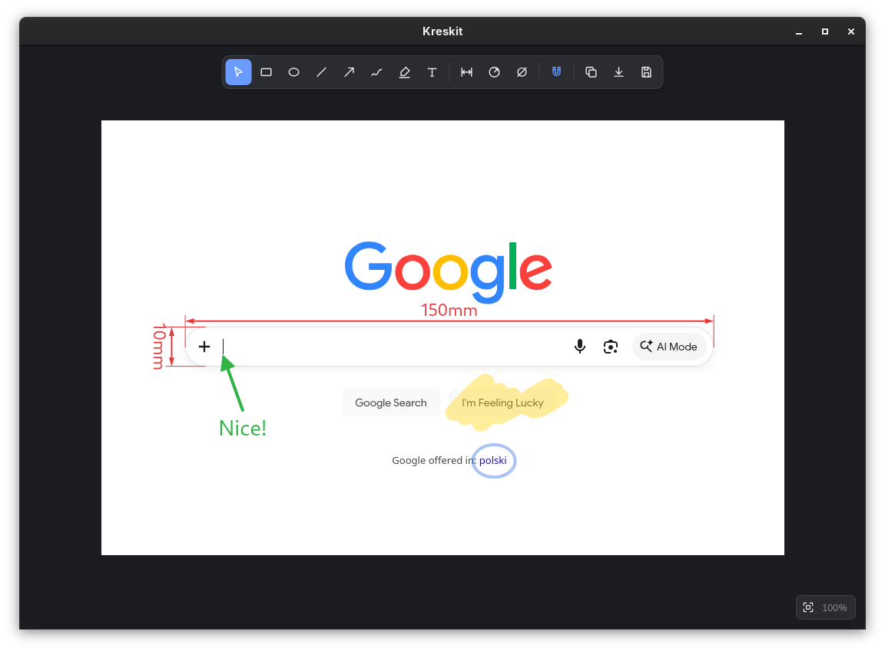
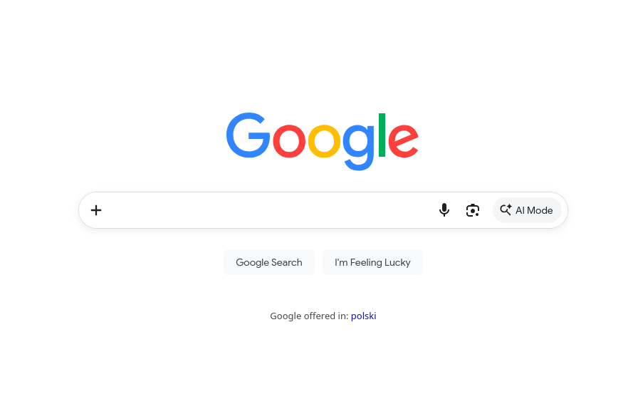
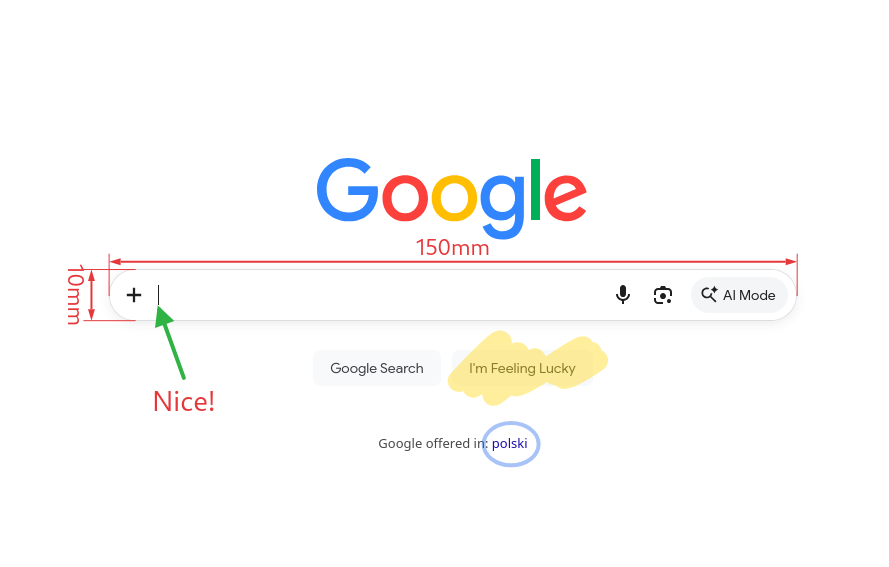

# Kreskit

[](#how-this-was-made)
[](https://claude.com/claude-code)


Fast screenshot annotation. Paste a screenshot, mark it up, and copy or export the result. Every annotation stays editable, so nothing is baked into the image until you export it.

<p align="center">
  
</p>

## Before and after

<p align="center">
  
  
</p>
<p align="center">
  <sub><b>Before</b>: the screenshot as pasted. <b>After</b>: marked up in Kreskit. The editable project is in <a href="example/editable.kit"><code>example/editable.kit</code></a>.</sub>
</p>

## What it can do

The annotated screenshot above uses most of these:

- **Dimensions**: linear, radius and diameter dimensions with arrows and extension lines, like the `150mm` and `10mm` above. You type the value.
- **Annotation tools**: rectangle, ellipse, line, arrow, pen, highlighter and text.
- **Editable objects**: select, move, resize, restyle, duplicate and reorder anything you have drawn, with undo and redo.
- **Snapping**: align objects to each other while drawing or editing; toggle it on or off at any time.
- **Get an image in quickly**: paste from the clipboard, drop a file onto the window, or open one with the file picker.
- **Export**: PNG, JPG, SVG or PDF, or copy the flattened image straight to the clipboard.
- **Project files**: save your work as a `.kit` file and reopen it later with every annotation still editable.

Kreskit is a desktop app built with [Tauri 2](https://tauri.app), TypeScript, [Vite](https://vite.dev) and [Konva](https://konvajs.org).

## How this was made

Kreskit is vibe-coded, and this page does not hide it. The code was written by an AI assistant ([Claude Code](https://claude.com/claude-code)) and directed by a human: Szymon decided what the app should do, tried every stage in the real app, and sent back what to fix or change. The AI did not click through the app itself, so everything interactive was tested by hand.

What that means if you use it:

- It is a personal tool that works for its author, not a reviewed or audited product.
- There are no automated tests.
- It has only been built and run on Linux (Fedora, Wayland). Windows and macOS should work, since Tauri supports them, but nobody has tried.

Bug reports are welcome.

## Getting started

### Prerequisites

- [Node.js](https://nodejs.org) and npm
- [Rust](https://rustup.rs)
- The Tauri system dependencies for your platform; see the [Tauri prerequisites](https://tauri.app/start/prerequisites/)

### Run in development

```sh
npm install
npm run tauri dev
```

### Build a release

```sh
npm run tauri build
```

The installers and binary end up in `src-tauri/target/release/bundle/`.

The frontend also runs in a plain browser with `npm run dev` (at http://localhost:1420), with the limits a browser imposes: exports download in the first offered format instead of asking where to save.

## Keyboard shortcuts

### Tools

| Key | Tool |
| --- | --- |
| `V` | Select |
| `R` | Rectangle |
| `O` | Ellipse |
| `L` | Line |
| `A` | Arrow |
| `P` | Pen |
| `H` | Highlighter |
| `T` | Text |
| `D` | Dimension (hold `Shift` to lock horizontal/vertical) |
| `Shift+R` | Radius |
| `Shift+D` | Diameter |
| `S` | Toggle snapping |
| `Esc` | Back to Select, or clear the selection |

### Files and clipboard

| Key | Action |
| --- | --- |
| `Ctrl+V` | Paste an image |
| `Ctrl+O` | Open an image or `.kit` project |
| `Ctrl+S` | Save the editable project |
| `Ctrl+E` | Export as PNG, JPG, SVG or PDF |
| `Ctrl+C` | Copy the image to the clipboard |

### Editing

| Key | Action |
| --- | --- |
| `Ctrl+Z` | Undo |
| `Ctrl+Shift+Z` / `Ctrl+Y` | Redo |
| `Ctrl+A` | Select all |
| `Ctrl+D` | Duplicate |
| `Ctrl+]` / `Ctrl+[` | Move forward / backward (add `Shift` for front / back) |
| `Delete` / `Backspace` | Delete the selection |
| Arrow keys | Nudge the selection by 1 px (`Shift` for 10 px) |

### View

| Key | Action |
| --- | --- |
| `Ctrl+0` | Fit the image to the window |
| `Ctrl+1` | Actual size |
| `Ctrl+=` / `Ctrl+-` | Zoom in / out |
| Scroll wheel / pinch | Zoom at the pointer |
| `Space` + drag | Pan |

## Project layout

```
index.html        Toolbar markup and app shell
src/              Frontend (TypeScript)
  main.ts         Wires the UI, shortcuts and file actions together
  editor.ts       Konva rendering and pointer/key input
  model.ts        Document and object types
  store.ts        Document state with undo/redo
  dimension.ts    Dimension geometry
  export.ts       PNG, JPG, SVG and PDF output
  files.ts        Save/open dialogs, clipboard and .kit project files
src-tauri/        Rust shell: window, plugins, bundling config
public/fonts/     Font embedded into PDF exports
```

## Notes

- PDF exports set all text in DejaVu Sans, whatever font the text object uses, because PDF's built-in fonts only cover Western European letters.
- A `.kit` file is JSON with the base image and any placed pictures embedded as PNG data URLs. Projects saved as `.shot` by earlier versions still open.
- The files in [`example/`](example/) are the app screenshot, the plain screenshot, its annotated export and the editable project shown at the top of this page.
